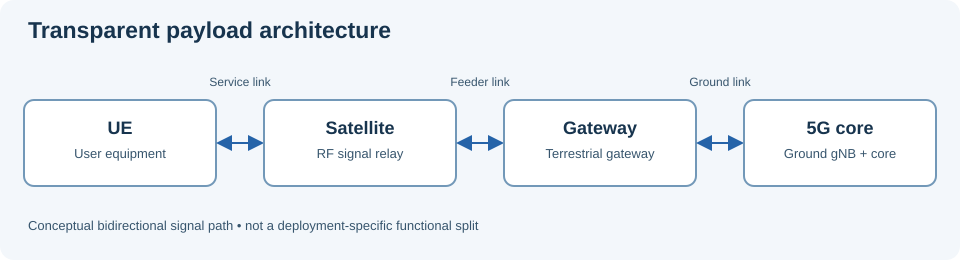
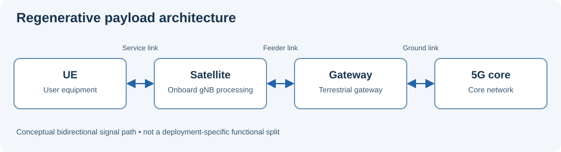

# 5G Non-Terrestrial Networks (NTN)

A telecommunications research project examining the integration of satellite and aerial communication platforms with terrestrial 5G networks to extend connectivity to underserved regions.

## Objective

Analyze the architecture, radio-link constraints and multiple access approaches of 5G NTN, with emphasis on coverage, reliability and the engineering trade-offs of satellite mobility and propagation distance.

## Technical scope

- LEO, MEO, GEO and high-altitude platform stations (HAPS)
- Transparent and regenerative satellite payload architectures
- 3GPP Release 17 and Release 18 as discussed in the original paper
- Propagation delay, Doppler shift, synchronization, handover and OFDM peak-to-average power ratio (PAPR)
- Modulation and coding schemes (MCS), link adaptation and block error rate (BLER)
- Link budget considerations: path loss, antennas, atmospheric attenuation and interference
- OMA, NOMA, SDMA and RSMA multiple access techniques

## Network architecture

### Transparent payload

### Regenerative payload

The diagrams are conceptual illustrations of the architectures described in the paper, not deployed network designs.

## Key findings

| Topic | Research takeaway |
|---|---|
| Orbit selection | LEO reduces propagation distance relative to GEO, but increases mobility and handover complexity. |
| Payload architecture | Transparent payloads relay signals to ground-based processing; regenerative payloads move processing onboard. |
| Doppler | Relative satellite motion requires frequency compensation and synchronization. |
| Link adaptation | Modulation and coding must respond to link quality and error performance. |
| Link budget | Antenna directionality, propagation losses, weather and interference affect received signal quality. |
| Multiple access | OMA, NOMA, SDMA and RSMA offer different resource-sharing and interference-management trade-offs. |

## Documentation

| Resource | Description |
|---|---|
| [Research paper](report/5G_NTN_Research_Paper.pdf) | Original five-page academic report |
| [System architecture](docs/system_architecture.md) | Payload types, components and signal paths |
| [Orbital analysis](docs/orbital_analysis.md) | Orbit characteristics and radio-link challenges |
| [Modulation and coding](docs/modulation_and_coding.md) | MCS, BLER and link adaptation |
| [Link budget](docs/link_budget.md) | Qualitative RF link-budget considerations |
| [Multiple access](docs/multiple_access.md) | Comparison of four access techniques |
| [Applications and challenges](docs/applications_and_challenges.md) | Coverage, IoT and deployment trade-offs |
| [References](docs/references.md) | Sources listed in the original report |

## Requirements and reproduction

No programming environment, hardware, API credentials or software dependencies are required to read this research project. A web browser and PDF viewer are sufficient. The documentation summarizes the original report and does not claim an implemented network, numerical simulation or measured performance.

## Limitations and future work

The original work is a literature-based technical analysis. Future extensions could include propagation-delay calculations, free-space path-loss analysis, Doppler modeling and link-level simulation. These extensions are not implemented in this repository package. Release-specific and performance claims in the original report reflect its research context and should be checked against the relevant 3GPP specifications before use in engineering design.

## Author

J. Sai Shanmukhnath — Electrical and Computer Engineering.
